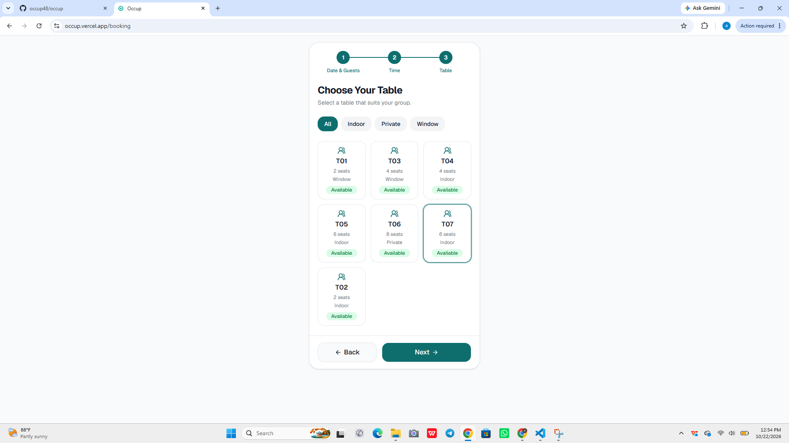
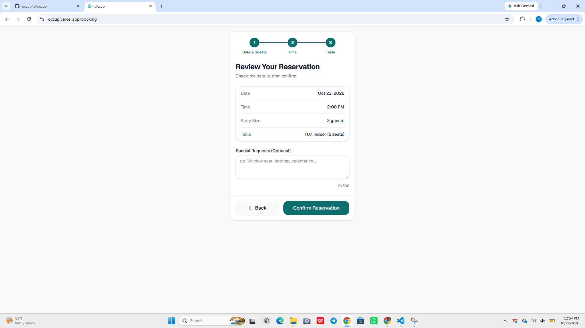
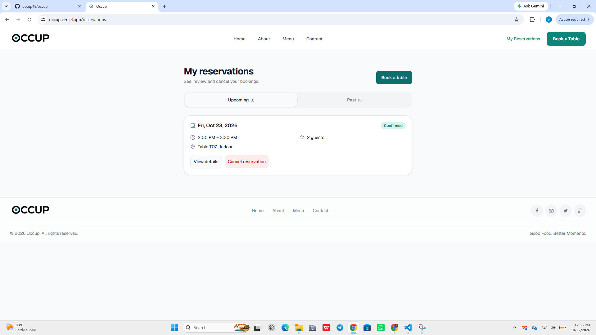

# Occup

Occup is a restaurant table-booking web app. Guests pick a date, party size and time, see which tables are free, book one, and later view or cancel their reservations.

**Live demo:** https://occup.vercel.app

## Screenshots

| Booking flow | My reservations | Cancel confirmation |
| --- | --- | --- |
|  |  |  |

## Features

- Search availability by date, guests and time slot, with times checked in the restaurant's own timezone
- Book a table; double bookings are blocked by a database exclusion constraint, not just app code
- Sign in, and return to the booking you were making
- View upcoming and past reservations, open a booking's details, and cancel it
- Cancellation is race-safe: one atomic database update, so two clicks or two devices cannot conflict

## Tech stack

| Area | Tools |
| --- | --- |
| Frontend | React, TypeScript, Vite, Tailwind CSS |
| Backend | Node.js, Express, Zod, drizzle-orm |
| Database | PostgreSQL (Neon) |
| Testing | node:test, PGlite (real Postgres in memory), Playwright |
| Hosting | Vercel |

## My role

Occup is a team project. I built:

- **Customer reservations, end to end.** The API (list, detail, cancel) and the screens that use it, including sign-in redirects, session expiry and server-conflict handling.
- **Booking flow fixes.** Restaurant-timezone handling so "today" and past time slots are correct, pre-filled booking links, and a calendar that starts on the first bookable day.
- **Tests.** Backend integration tests that run the real SQL migrations against an in-memory Postgres, plus Playwright browser tests for the reservations screens.

## Run it locally

```bash
git clone https://github.com/occup48/occup.git
cd occup

# backend
cd backend
npm install
cp .env.example .env.local   # add your DATABASE_URL and JWT_SECRET
npm run dev

# frontend (new terminal)
cd frontend
npm install
cp .env.example .env.local   # defaults point at the backend on port 5000
npm run dev
```

## Tests

```bash
cd backend && npm test      # API and database tests
cd frontend && npm test     # unit tests
```

Browser tests run with Playwright; see `frontend/tests/`.
